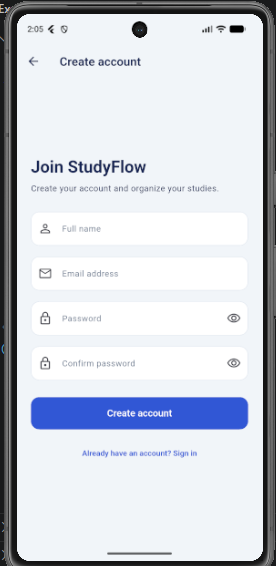
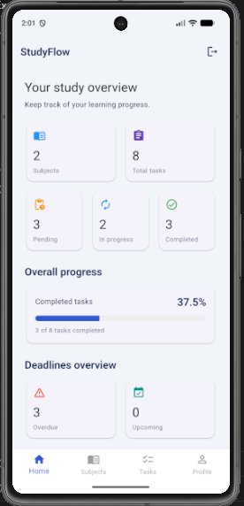
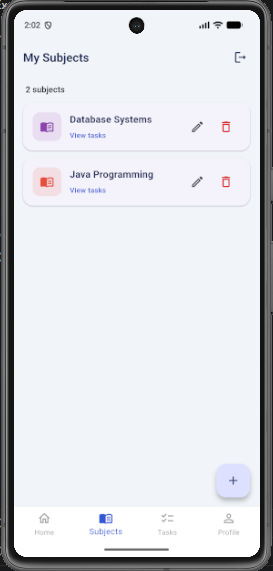
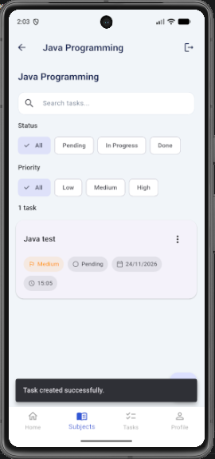
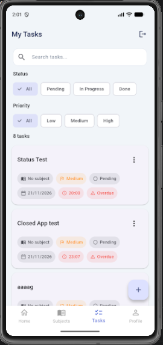
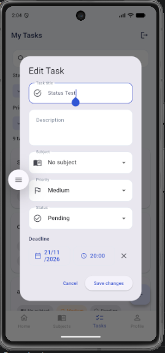

# StudyFlow

### Application mobile de gestion et d'organisation des études

StudyFlow est une application mobile multiplateforme destinée aux étudiants. Elle permet d'organiser le travail universitaire, de gérer les matières, de suivre les tâches et les échéances, et de consulter sa progression académique à travers une interface simple et intuitive.

Le projet repose sur une architecture orientée services (SOA), avec une application mobile Flutter, un backend Java basé sur les services Web SOAP, une base de données MySQL et un microservice Node.js dédié à l'envoi des e-mails.

---

## Sommaire

- [Présentation du projet](#présentation-du-projet)
- [Fonctionnalités principales](#fonctionnalités-principales)
- [Captures d'écran](#captures-décran)
- [Architecture du système](#architecture-du-système)
- [Technologies utilisées](#technologies-utilisées)
- [Structure du projet](#structure-du-projet)
- [Prérequis](#prérequis)
- [Installation et configuration](#installation-et-configuration)
- [Exécution du projet](#exécution-du-projet)
- [Tests](#tests)
- [Sécurité](#sécurité)

## Présentation du projet

StudyFlow a pour objectif de faciliter l'organisation quotidienne des étudiants en centralisant leurs activités académiques dans une seule application.

L'application permet notamment de :

- Gérer les matières étudiées.
- Organiser les tâches et les devoirs.
- Suivre les échéances et les priorités.
- Visualiser l'avancement du travail.
- Consulter un tableau de bord personnalisé.
- Recevoir des notifications concernant les tâches.

## Fonctionnalités principales

### 1. Authentification et gestion du profil
- Inscription et connexion des utilisateurs.
- Authentification basée sur un système de jetons (tokens).
- Consultation et gestion des informations personnelles.
- Récupération du mot de passe par e-mail.

### 2. Gestion des matières
- Ajouter de nouvelles matières.
- Consulter la liste des matières.
- Modifier les informations d'une matière.
- Supprimer une matière.
- Consulter les tâches associées à chaque matière.

### 3. Gestion des tâches
- Créer, modifier et supprimer des tâches.
- Définir une description et une date limite.
- Attribuer un niveau de priorité : faible, moyen ou élevé.
- Suivre l'état d'avancement : en attente, en cours ou terminée.
- Gérer les tâches indépendamment d'une matière.

### 4. Tableau de bord
- Visualiser les informations académiques principales.
- Consulter les tâches à réaliser.
- Suivre la progression des activités.
- Obtenir une vue globale de son organisation.

### 5. Notifications
- Recevoir des notifications locales.
- Être informé des tâches et des échéances importantes.

## Captures d'écran

Cette section présente les principales interfaces de l'application mobile StudyFlow.

> Pour afficher les captures, ajoute les images dans le dossier `screenshots/` à la racine du projet, en utilisant les noms de fichiers indiqués ci-dessous.

### Authentification

| Connexion | Inscription |
|---|---|
|  |  |

### Tableau de bord



### Gestion des matières

| Liste des matières | Détails d'une matière |
|---|---|
|  |  |

### Gestion des tâches

| Liste des tâches | Détails d'une tâche |
|---|---|
|  |  |

### Profil utilisateur


## Architecture du système

StudyFlow adopte une architecture client-serveur basée sur l'approche SOA (Service-Oriented Architecture).

```text
              +---------------------------+
              |    Application mobile     |
              |       Flutter / Dart      |
              +-------------+-------------+
                            |
                       SOAP / XML
                            |
              +-------------v-------------+
              |       Backend Java        |
              |        GlassFish 5        |
              +-------------+-------------+
                            |
              +-------------v-------------+
              |      Base de données      |
              |          MySQL            |
              +---------------------------+

              +---------------------------+
              |    Microservice Email     |
              |      Node.js / Express    |
              +-------------+-------------+
                            |
                       Envoi d'e-mails
```

**Description des composants :**

- **Application mobile :** interface utilisateur développée avec Flutter.
- **Backend Java :** expose les services SOAP et assure le traitement des opérations métier.
- **Base de données MySQL :** assure le stockage des données de l'application.
- **Microservice Email :** prend en charge les fonctionnalités liées à l'envoi d'e-mails.

## Technologies utilisées

| Domaine | Technologies |
|---|---|
| Application mobile | Flutter, Dart |
| Backend | Java, SOAP, XML, JAXB |
| Serveur d'applications | GlassFish 5 |
| Base de données | MySQL |
| Microservice Email | Node.js, Express.js |
| Envoi d'e-mails | Nodemailer |
| Gestion de dépendances Java | Maven |
| Versionnement | Git, GitHub |

## Structure du projet

```text
StudyFlow/
│
├── studyflow_mobile_new/       # Application mobile Flutter
│
├── studyFlow-backend/          # Backend Java et services SOAP
│
├── studyflow-email-service/    # Microservice d'envoi d'e-mails
│
├── subject-service.wsdl        # Contrat du service SOAP
├── subject-service.xsd         # Schéma XML
│
├── screenshots/                # Captures d'écran de l'application
│   ├── login.png
│   ├── register.png
│   ├── dashboard.png
│   ├── subjects.png
│   ├── subject_details.png
│   ├── tasks.png
│   ├── task_details.png
│   └── profile.png
│
└── README.md
```

## Prérequis

Avant de lancer le projet, il est nécessaire d'installer :

- Flutter SDK et Dart SDK.
- Java Development Kit (JDK compatible avec GlassFish).
- Apache Maven.
- GlassFish 5.
- MySQL Server.
- Node.js et npm.
- Android Studio ou un environnement compatible avec Flutter.

## Installation et configuration

### 1. Cloner le dépôt

```bash
git clone https://github.com/aminelanouar3/StudyFlow.git
cd StudyFlow
```

### 2. Configurer la base de données

Créer la base de données MySQL :

```sql
CREATE DATABASE studyflow_db;
```

Configurer les paramètres de connexion dans le fichier `DatabaseConnection.java` du backend.

Configuration locale par défaut :

```text
Hôte       : localhost
Port       : 3306
Base       : studyflow_db
Utilisateur: root
Mot de passe: vide par défaut
```

S'assurer que les tables nécessaires sont créées avant de lancer l'application.

### 3. Configurer le backend Java

Accéder au dossier :

```bash
cd studyFlow-backend
```

Configurer les variables d'environnement nécessaires au service e-mail dans le fichier `.env` attendu par le backend.

Compiler le projet :

```bash
mvn clean package
```

Le fichier WAR généré se trouve dans :

```text
target/studyflow-backend.war
```

Déployer ce fichier sur GlassFish 5 et démarrer le serveur.

### 4. Configurer le microservice Email

Accéder au dossier :

```bash
cd studyflow-email-service
```

Installer les dépendances :

```bash
npm install
```

Créer un fichier `.env` local contenant les variables suivantes :

```env
STUDYFLOW_EMAIL=your_email@gmail.com
STUDYFLOW_EMAIL_PASSWORD=your_email_app_password
STUDYFLOW_EMAIL_API_KEY=your_api_key
```

Remplacer les valeurs d'exemple par les informations de configuration réelles.

### 5. Configurer l'application mobile

Accéder au dossier :

```bash
cd studyflow_mobile_new
```

Installer les dépendances Flutter :

```bash
flutter pub get
```

Configurer l'adresse du backend dans la configuration existante de l'application mobile.

## Exécution du projet

Pour exécuter l'ensemble du système :

1. Démarrer le serveur MySQL.
2. Démarrer GlassFish 5 et déployer le backend Java.
3. Démarrer le microservice Node.js avec sa commande de lancement configurée.
4. Lancer l'application Flutter sur un émulateur ou un appareil physique.

Commande de lancement Flutter :

```bash
flutter run
```

Pour afficher les appareils disponibles :

```bash
flutter devices
```

## Tests

### Analyse statique Flutter

```bash
cd studyflow_mobile_new
flutter analyze
```

### Tests Flutter

```bash
flutter test
```

### Compilation du backend Java

```bash
cd studyFlow-backend
mvn clean package
```

## Sécurité

- Les fichiers `.env` ne doivent jamais être publiés sur GitHub.
- Les mots de passe et les clés API doivent rester confidentiels.
- Les identifiants de connexion à MySQL doivent être adaptés à l'environnement local.
- L'adresse du backend doit correspondre à celle accessible depuis l'émulateur ou l'appareil mobile.

## Auteur et contexte académique

StudyFlow est un projet académique réalisé dans le cadre de la formation en Licence Technologies de l'Informatique, spécialité Développement des Systèmes d'Information (DSI).

**Dépôt GitHub :**  
https://github.com/aminelanouar3/StudyFlow
